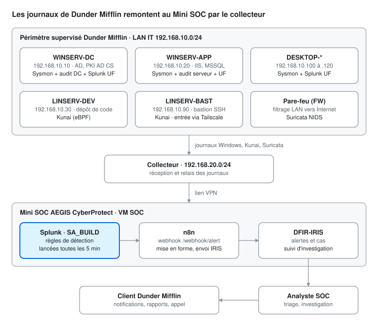

# Architecture supervisée, sources et types de données

Les journaux des postes et serveurs de Dunder Mifflin passent par un collecteur dédié (192.168.20.0/24), puis remontent par lien VPN vers la VM SOC. Sur cette VM, Splunk détecte, n8n relaie et DFIR-IRIS porte le traitement. Aucun service du LAN IT n'est exposé sur Internet, et les accès distants passent par le bastion LINSERV-BAST via Tailscale.

> L'environnement de production (RUN) n'est accessible qu'à partir du 09/11/2026. Les éléments marqués **à confirmer en RUN** (nom d'index, sourcetypes exacts) seront complétés à ce moment-là.

## Actifs supervisés en production

| Actif | Adresse | Rôle | Collecte | Criticité |
|---|---|---|---|---|
| WINSERV-DC | 192.168.10.10 | Contrôleur de domaine, PKI AD CS | Sysmon, journaux Security/System (politique d'audit DC), Splunk UF | Tier 0 |
| WINSERV-APP | 192.168.10.20 | Web IIS, base MSSQL, partage de fichiers | Sysmon, journaux Security/System (politique d'audit serveurs), Splunk UF | Élevée |
| LINSERV-DEV | 192.168.10.30 | Dépôt de code, partage de fichiers, coffre d'identifiants | Kunai | Élevée |
| LINSERV-BAST | 192.168.10.90 | Bastion d'accès (SSH, rebond RDP), point d'entrée Tailscale | Kunai | Élevée |
| DESKTOP-* (DEV, ADMIN, VIP, AD-ADMIN) | 192.168.10.100 à .120 | Postes de travail | Sysmon, Splunk UF | Moyenne, élevée pour ADMIN, VIP et AD-ADMIN |
| Pare-feu (FW) | Bordure | Filtrage du LAN IT et du collecteur vers Internet | Suricata (NIDS) | Élevée |

## Comptes sensibles

| Groupe AD | Membres | Pourquoi c'est sensible |
|---|---|---|
| AD-Admins | J.Halpert, R.Howard, groupe VIPs | Contrôle total du domaine |
| VIPs | M.Scott (Regional Manager), D.Schrute (Assistant to the Regional Manager) | Membres d'AD-Admins et cibles privilégiées |
| Servers-Admins | A.Martin, K.Kapoor, A.Bernard | Administration des serveurs |
| Desktop-Admins / Dev-DevOps | P.Beesly, P.Vance, O.Martinez, S.Hudson | Administration des postes, accès au code |

Toute alerte qui touche un actif Tier 0 ou un compte de ces groupes est relevée d'un niveau de sévérité (voir [la matrice de priorisation](matrice_priorisation_triage.md)).

## Plateforme SOC

| Composant | Fonction | Accès |
|---|---|---|
| Splunk Enterprise, app SA_BUILD | Indexation, règles de détection planifiées (`savedsearches.conf`) | HTTPS, port 8000 |
| n8n | Réception du webhook Splunk (`/webhook/alert`), mise en forme, envoi à IRIS | Port 5678 via tunnel SSH (port 2222) |
| DFIR-IRIS | Alertes, cas, suivi d'investigation | HTTPS |

## Lab de test (BUILD)

| VM | Rôle | Adresse |
|---|---|---|
| pfSense | Pare-feu et routeur du lab | LAN 192.168.20.1 |
| SOC | Splunk et DFIR-IRIS du lab | 192.168.20.11 |
| DC-G2 | Contrôleur de domaine `test.local` | 192.168.20.100 |
| SRV-G2 | Serveur membre du domaine | 192.168.20.101 |
| Kali-G2 | Machine offensive pour les tests unitaires | 192.168.20.200 |

Le lab ne contient ni serveur Linux sous Kunai ni Suricata. Les règles Linux et Réseau sont donc validées par relecture de la collecte, comme le prévoit le sujet, puis vérifiées en RUN.

## Sources et types de données

Quatre familles de sources couvrent le périmètre :
- Sysmon et les journaux d'audit Windows, pour les postes et serveurs Windows ;
- Kunai, pour les serveurs Linux ;
- Suricata, pour le réseau.

Dans le lab, tout est indexé dans `index=main`. L'index et les sourcetypes de production sont à confirmer en RUN.

| Source | Hôtes | Type de données | Événements utilisés |
|---|---|---|---|
| Sysmon (config sysmon-modular, identique sur tous les endpoints) | Tous les Windows | Activité processus, réseau, registre, fichiers | 1 création de processus, 3 connexion réseau, 7 chargement d'image, 8 thread distant, 10 accès processus (LSASS), 11 création de fichier, 12/13/14 registre, 17/18 pipes nommés, 19/20/21 WMI, 22 requête DNS, 23 suppression de fichier |
| Journal Security, politique d'audit DC | WINSERV-DC | Authentification, Kerberos, annuaire, comptes et groupes | 4624/4625 ouverture de session, 4648 identifiants explicites, 4768/4769/4771 Kerberos, 4662 accès annuaire, 5136 modification d'objet AD, 4720/4728/4732/4756 comptes et groupes, 4740 verrouillage, 4698 tâche planifiée, 4697 service, 4688 processus, 4719 politique d'audit, 1102 journal effacé |
| Journal Security, politique d'audit serveurs | WINSERV-APP | Authentification locale, comptes, processus | 4624/4625, 4776 validation NTLM, 4720/4728/4732, 4688, 4697, 4698 |
| Journal System | Windows | Services | 7045 installation de service |
| Kunai (eBPF, identique sur tous les serveurs Linux) | LINSERV-DEV, LINSERV-BAST | Exécutions, réseau, accès fichiers, modules noyau | execve, connect, dns_query, lectures et écritures de fichiers sensibles, init_module (noms exacts des champs à valider en RUN) |
| Suricata (eve.json) | Pare-feu | Flux réseau et signatures IDS | alert, flow, dns, http, tls |

## Couverture des règles par source

| ID | Règle | Source principale |
|---|---|---|
| DM-AD-001 | Kerberoasting | Security DC 4769 (chiffrement RC4) |
| DM-AD-002 | AS-REP Roasting | Security DC 4768 (pré-authentification désactivée) |
| DM-AD-003 | Shadow Credentials | Security DC 5136 (msDS-KeyCredentialLink) |
| DM-AD-004 | Password spraying | Security DC 4625 |
| DM-AD-005 | DCSync | Security DC (4662 en prod ; logon réseau sur le DC utilisé comme proxy dans le lab) |
| DM-AD-006 | Ajout à un groupe AD critique | Security DC 4728, 4732, 4756 |
| DM-AD-007 | Extraction de NTDS.dit | Sysmon 1, 11 |
| DM-AD-008 | Modification d'une délégation Kerberos | Security DC 5136, 4738 |
| DM-WIN-001 | Tâche planifiée suspecte | Security 4698, Sysmon 1 |
| DM-WIN-002 | Service suspect | System 7045, Security 4697 |
| DM-WIN-003 | Clé Run | Sysmon 12/13 |
| DM-WIN-004 | Dump LSASS | Sysmon 10 (non collecté dans le lab), Sysmon 1, 11 |
| DM-WIN-005 | Impacket WMIExec | Sysmon 1 (parent wmiprvse.exe), Security 4624 |
| DM-WIN-006 | Enfant inhabituel de WmiPrvSE | Sysmon 1 |
| DM-WIN-007 | Effacement des journaux | Security 1102, System 104, Sysmon 1 |
| DM-WIN-008 | Modification de la politique d'audit | Security 4719, Sysmon 1 |
| DM-WIN-009 | LOLBin | Sysmon 1 |
| DM-LIN-* | Énumération, password looting | Kunai |
| DM-NET-* | Scan de ports, beaconing C2 | Suricata, Sysmon 3 |

Le détail des champs, des exclusions et des contournements connus de chaque règle se trouve dans son YAML, sous [`Detection/`](../Detection/).
