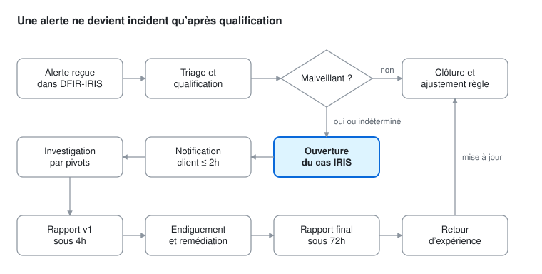

# Investigation

Une alerte ne devient un incident qu'après qualification. Les SLA client courent depuis l'heure de l'alerte, pas depuis sa prise en charge (voir la [matrice de priorisation](../Documentation/matrice_priorisation_triage.md)).

- [Librairie de pivots](pivots.md) : requêtes SPL réutilisables, référencées par les YAML des règles.
- [Fiches réflexes](fiches_reflexes/) : une fiche par règle, avec triage en 5 questions, faux positifs fréquents, endiguement et remédiation.

## Workflow d'investigation

1. **Réception.** La règle Splunk se déclenche (cron toutes les 5 min, fenêtre `-10m@m` à `-5m@m`). Le webhook n8n crée l'alerte dans DFIR-IRIS avec son titre, sa sévérité, l'hôte concerné et un lien vers la recherche Splunk.
2. **Prise en charge.** L'analyste s'assigne l'alerte dans IRIS et note l'heure de début. Il regroupe les alertes liées (même hôte, même compte, même LogonId).
3. **Triage et qualification.** L'analyste applique la matrice de priorisation. Il relit l'événement brut, vérifie les exclusions connues dans le YAML de la règle, puis lance les pivots de premier niveau (P-PROC-TREE, P-USER-LOGONS, P-SRC-IP-SCOPE). Il conclut à l'une des quatre issues : faux positif, vrai positif bénin, malveillant ou indéterminé.
4. **Faux positif ou bénin.** L'alerte est clôturée dans IRIS avec une justification. La règle est ensuite ajustée, ou une exclusion est ajoutée, selon le [processus MCD](../Documentation/process_MCO_MCD.md).
5. **Ouverture du cas.** Pour un malveillant ou un indéterminé, l'analyste crée un cas IRIS, fixe la sévérité finale après application des modificateurs et attribue un numéro d'incident, qui sert de base à la nomenclature client.
6. **Notification client.** Pour un HIGH ou un CRITICAL, la notification part sous 2h dans le canal Teams du groupe, avec un appel téléphonique si l'attaque est en cours. Elle contient déjà les recommandations d'endiguement immédiat.
7. **Investigation par pivots.** L'analyste reconstitue la chaîne d'attaque : point d'entrée, comptes utilisés, hôtes touchés, persistance, communications sortantes. Chaque pivot est noté dans IRIS (question, requête, résultat, conclusion) et rattaché à une étape de la kill chain.
8. **Rapport d'investigation v1.** Pour un HIGH ou un CRITICAL, il est remis sous 4h. Il contient une synthèse qui justifie la qualification, le périmètre connu, les inconnues prioritaires et les recommandations.
9. **Endiguement et remédiation.** Les mesures viennent de la fiche réflexe de la règle (isolement d'hôte, désactivation ou reset de compte, suppression de la persistance). Le SOC les propose, le client décide et les exécute, puis le SOC vérifie leur effet dans les journaux.
10. **Rapport final et clôture.** Il est remis sous 72h, avec la chronologie complète, les IOC, les actions menées et celles qui restent à mener. Le cas IRIS est ensuite clôturé.
11. **Retour d'expérience.** Il produit de nouvelles règles ou exclusions, documente les contournements observés et enrichit la librairie de pivots.

En pratique, les étapes 7 à 9 se chevauchent : quand l'attaquant est actif, l'endiguement n'attend pas la fin de l'investigation.

## Fiches réflexes

| Règle | Titre | Sévérité |
|---|---|---|
| [DM-AD-001](fiches_reflexes/DM-AD-001.md) | Kerberoasting - demande de tickets de service en RC4 | MEDIUM |
| [DM-AD-002](fiches_reflexes/DM-AD-002.md) | AS-REP Roasting - AS-REQ sans pre-authentification | MEDIUM |
| [DM-AD-003](fiches_reflexes/DM-AD-003.md) | Shadow Credentials - modification de msDS-KeyCredentialLink | HIGH |
| [DM-AD-004](fiches_reflexes/DM-AD-004.md) | Password spraying | MEDIUM |
| [DM-AD-005](fiches_reflexes/DM-AD-005.md) | DCSync - replication d'annuaire par un compte non DC | CRITICAL |
| [DM-AD-006](fiches_reflexes/DM-AD-006.md) | Ajout d'un membre a un groupe AD critique | HIGH |
| [DM-AD-007](fiches_reflexes/DM-AD-007.md) | Extraction de NTDS.dit | CRITICAL |
| [DM-AD-008](fiches_reflexes/DM-AD-008.md) | Modification d'une delegation Kerberos | HIGH |
| [DM-WIN-001](fiches_reflexes/DM-WIN-001.md) | Creation d'une tache planifiee suspecte | MEDIUM |
| [DM-WIN-002](fiches_reflexes/DM-WIN-002.md) | Creation d'un service suspect | HIGH |
| [DM-WIN-003](fiches_reflexes/DM-WIN-003.md) | Creation ou modification d'une cle Run | MEDIUM |
| [DM-WIN-004](fiches_reflexes/DM-WIN-004.md) | Dump de la memoire LSASS | CRITICAL |
| [DM-WIN-005](fiches_reflexes/DM-WIN-005.md) | Impacket WMIExec - execution de commandes a distance | HIGH |
| [DM-WIN-006](fiches_reflexes/DM-WIN-006.md) | Processus enfant inhabituel de WmiPrvSE (variante silentcommand) | MEDIUM |
| [DM-WIN-007](fiches_reflexes/DM-WIN-007.md) | Effacement des journaux d'evenements | HIGH |
| [DM-WIN-008](fiches_reflexes/DM-WIN-008.md) | Modification de la politique d'audit | HIGH |
| [DM-WIN-009](fiches_reflexes/DM-WIN-009.md) | Utilisation de LOLBin pour telechargement ou execution | MEDIUM |
